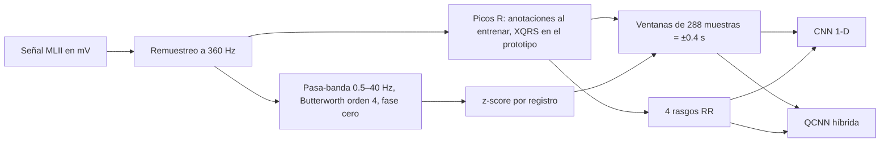
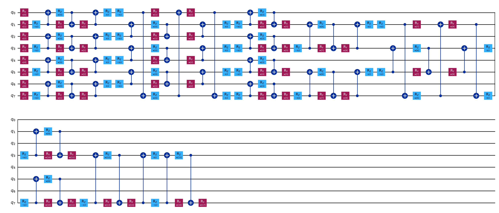
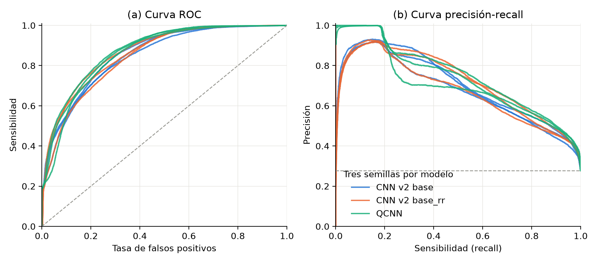
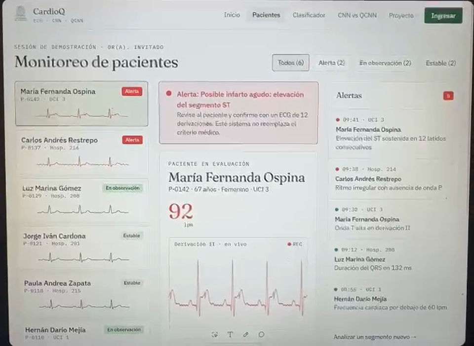

# CNN 1-D frente a una QCNN híbrida simulada para la clasificación binaria de latidos de ECG: comparación controlada de desempeño y costo de circuito

**Juan José Barrientos Salazar¹, Brayan Stiven Tobón Foronda¹, Didian Alejandro Valencia Ruíz¹, Javier Fernando Botia Valderrama¹**

¹ Facultad de Ingeniería, Universidad de Antioquia, Medellín, Colombia
{juanj.barrientos, bstiven.tobon, didian.valencia, javier.botia}@udea.edu.co

*Proyecto Integrador I, Ingeniería de Sistemas, semestre 2026-2.*

> Resultado experimental con fines académicos. El sistema descrito no constituye una herramienta de diagnóstico médico.

---

## Resumen

Las redes convolucionales clasifican latidos de electrocardiograma (ECG) con buen desempeño, pero con miles o millones de parámetros. Las redes neuronales convolucionales cuánticas (QCNN) prometen modelos con muy pocos parámetros, aunque la evidencia se basa sobre todo en imágenes de referencia y rara vez reporta el costo del circuito. Este trabajo compara, bajo condiciones experimentales idénticas, una CNN 1-D y una QCNN híbrida de 8 qubits ejecutada en simulador, en la clasificación binaria (normal frente a anormal) de latidos de la MIT-BIH Arrhythmia Database con partición inter-paciente (DS1/DS2). Los dos modelos comparten el preprocesamiento, cuatro rasgos de ritmo (RR), los pliegues de validación cruzada por paciente, la regla de umbral y el ensamble de cinco modelos, y se evalúan una sola vez en 21 pacientes no vistos. Con 928 parámetros (18 de ellos cuánticos), la QCNN obtuvo un AUC-ROC de 0.869 ± 0.010 y un AUC-PR de 0.730 ± 0.026 (media ± desviación de 3 semillas), frente a 0.859 ± 0.013 y 0.699 ± 0.027 de la CNN con los mismos rasgos y 11 393 parámetros. Su F1 fue 0.601 ± 0.097, frente a 0.596 ± 0.055. El bootstrap pareado por paciente no muestra diferencias significativas: ΔAUC-ROC = +0.011, IC 95 % [−0.054, +0.077], y ΔF1 = +0.005, IC 95 % [−0.141, +0.154]. El circuito tiene ancho 8, profundidad 50 y 53 compuertas de dos qubits, que suben a 83 en una conectividad lineal. El costo está en la simulación: el gradiente por desplazamiento de parámetros de Qiskit tardó 173 s por lote de 256 latidos. Un simulador exacto en PyTorch, validado contra Qiskit, lo redujo a 0.15 s, y aun así la QCNN entrenó entre 4 y 5.5 veces más lento que la CNN. La QCNN iguala a la CNN con unas doce veces menos parámetros. Su umbral de decisión era inestable entre semillas, y una calibración anidada sobre el ensamble estabilizó el F1 en 0.623 ± 0.002. Una parte del trabajo la hace su etapa convolucional clásica. Se integraron ambos modelos en un prototipo (API REST e interfaz web).

**Palabras clave:** electrocardiograma; clasificación de latidos; redes neuronales convolucionales; aprendizaje automático cuántico; QCNN; costo de circuito; evaluación inter-paciente.

## Abstract

This work compares, under identical experimental conditions, a 1-D convolutional neural network (CNN) and a simulated 8-qubit hybrid quantum convolutional neural network (QCNN) for binary (normal vs. abnormal) heartbeat classification on the MIT-BIH Arrhythmia Database with an inter-patient split. Both models share preprocessing, four RR-interval features, patient-wise cross-validation folds, the decision-threshold rule and a five-model ensemble, and are evaluated once on 21 unseen patients. With 928 parameters (18 quantum), the QCNN reached ROC-AUC 0.869 ± 0.010, PR-AUC 0.730 ± 0.026 and F1 0.601 ± 0.097 (3 seeds), versus 0.859 ± 0.013, 0.699 ± 0.027 and 0.596 ± 0.055 for a CNN with the same inputs and 11,393 parameters; patient-level bootstrap shows no significant difference. The circuit has width 8, depth 50 and 53 two-qubit gates (83 on a linear topology). Training cost dominates: Qiskit's parameter-shift gradient took 173 s per batch of 256 beats, reduced to 0.15 s by an exact PyTorch statevector simulator validated against Qiskit. Both models were integrated in a prototype (REST API and web interface).

**Keywords:** ECG; heartbeat classification; CNN; quantum machine learning; QCNN; circuit cost.

---

## I. Introducción

Las enfermedades cardiovasculares son la principal causa de muerte en el mundo, y el ECG es la prueba más accesible para detectarlas. Adquirir la señal no es el problema; interpretarla sí: un registro Holter de 24 horas contiene alrededor de cien mil latidos. Las redes convolucionales han reducido esa carga con un desempeño comparable al de cardiólogos [1], y arquitecturas 1-D compactas clasifican latidos directamente sobre la señal [2], pero estos modelos suelen tener desde decenas de miles hasta millones de parámetros.

La QCNN [3] traslada la convolución y el agrupamiento a circuitos cuánticos parametrizados, y su número de parámetros crece de forma logarítmica con el número de qubits. Para quien deba decidir si adoptarla, la evidencia tiene tres vacíos: casi todos los experimentos usan imágenes como MNIST [4] y no señales fisiológicas 1-D; las comparaciones con modelos clásicos no siempre comparten datos, preprocesamiento y partición; y el costo del circuito, que determina si el modelo podría correr en el hardware actual [5], rara vez se reporta junto con el desempeño [6].

Este trabajo responde a la pregunta: *¿qué desempeño y qué costo de circuito alcanza una QCNN simulada frente a una CNN 1-D equivalente en la clasificación binaria de latidos de ECG?* Las contribuciones son:

1. Una comparación controlada en la MIT-BIH Arrhythmia Database [7], [8] con partición inter-paciente [9]: los dos modelos comparten preprocesamiento, rasgos, pliegues, regla de umbral, ensamble y semillas, y la prueba se evalúa una sola vez.
2. El costo del circuito de la QCNN (ancho, profundidad y compuertas de uno y dos qubits) reportado junto con sus métricas de clasificación, con y sin las restricciones de conectividad de un procesador.
3. Una medición del costo de entrenar la QCNN en simulador, y un simulador exacto en PyTorch que lo reduce unas 1 000 veces, validado contra Qiskit.
4. Un prototipo que integra los dos modelos detrás de una API con contrato explícito y una interfaz web.

Los objetivos del anteproyecto siguen la taxonomía de Bloom revisada [10]. El Apéndice A indica dónde se cumple cada uno y qué se desvió del plan.

## II. Marco teórico y trabajos relacionados

### A. El ECG y la ventana de análisis

El ECG es una secuencia periódica de ondas (P, QRS, T y, a veces, U) con nomenclatura y rangos de referencia estandarizados [11]. Ninguna onda es patológica en sí misma: lo anormal es un cambio de forma, amplitud o duración respecto de esos rangos, o del ritmo en que aparecen. De ahí tres decisiones de diseño: la ventana debe contener el complejo completo (0.6 a 0.8 s alrededor del pico R); la deriva de la línea de base debe corregirse antes de normalizar, porque un desplazamiento artificial del segmento ST imita un hallazgo; y el filtrado pasa-bajas no puede ser tan agresivo que elimine la onda U.

### B. Clasificación automática de latidos

Kiranyaz et al. [2] mostraron que una CNN 1-D compacta clasifica latidos sin extracción manual de características. Hannun et al. [1] escalaron el enfoque a una red profunda entrenada con 91 232 registros. Las bases de referencia más usadas son la MIT-BIH [7], con anotación latido a latido, y la PTB-XL [12], de doce derivaciones. La literatura coincide en dos dificultades: el desbalance de clases y la necesidad de separar pacientes entre entrenamiento y prueba. De Chazal et al. [9] propusieron la partición DS1/DS2 de la MIT-BIH, hoy estándar para la evaluación inter-paciente, y mostraron el valor de los intervalos RR, que otros trabajos combinaron con la morfología [14]. La norma AAMI EC57 [13] agrupa los latidos en cinco clases. En particular, cuenta los bloqueos de rama (L, R) como clase normal (N), una decisión que este trabajo no sigue (Sección III-B).

### C. QCNN y aprendizaje automático cuántico

Cong et al. [3] definieron la QCNN con unitarias de dos qubits de parámetros compartidos como filtro y con la eliminación de qubits como agrupamiento. Así, el número de qubits activos se reduce a la mitad en cada capa, y el de parámetros crece como O(log n). En hardware, el gradiente se estima con la regla de desplazamiento de parámetros [15], que exige dos evaluaciones del circuito por parámetro. Schuld et al. [16] formalizaron los circuitos parametrizados como clasificadores. Hur et al. [4] evaluaron la QCNN sobre datos clásicos con pocos parámetros libres. Los datos clásicos deben codificarse en el estado cuántico:

- La **codificación por ángulos** asigna cada característica a una rotación de un qubit: tiene poca profundidad, pero un qubit por característica.
- La **codificación por amplitud** empaqueta N valores en log₂ N qubits a cambio de un circuito de preparación profundo.
- Los mapas de características con entrelazamiento (ZZFeatureMap) proyectan los datos a un espacio de Hilbert de alta dimensión [17], [18].

Los circuitos profundos o anchos sufren mesetas estériles, en las que el gradiente se anula de forma exponencial [19]. Sim et al. [6] proponen caracterizar un circuito parametrizado por su ancho, su profundidad y su número de operaciones, en especial las de dos qubits, que son las más ruidosas en el hardware actual [5].

## III. Materiales y métodos

### A. Metodología de desarrollo

El proyecto se gestionó con Shape Up [20]: ciclos de apetito fijo, cada uno con un *pitch* de una página revisado con el profesor y alcances verticales que una persona termina de extremo a extremo. El historial del repositorio registra:

- **Ciclos 1–2 (hasta el 8 de octubre):** el conjunto de datos reproducible y la CNN 1-D de referencia.
- **11 de noviembre:** el backend.
- **16 y 17 de noviembre:** la CNN v2, la QCNN y su integración.

El ciclo 3 (QCNN e integración) terminó después de la fecha planeada del 7 de noviembre. Todo el código es Python 3.12 gestionado con `uv`, con pruebas automáticas (42 del paquete de modelos y 82 del backend). Los experimentos se ejecutaron en CPU (Intel Core i5-1145G7, 4 núcleos, 4 hilos de PyTorch).

### B. Datos

Se eligió la MIT-BIH Arrhythmia Database [7], distribuida por PhysioNet [8], sobre la PTB-XL [12] por su anotación latido a latido, que permite clasificar latidos y no registros completos. Contiene 48 registros de 30 min de 47 pacientes, muestreados a 360 Hz. Se usó la derivación MLII.

- **Exclusiones.** Se excluyeron los 4 registros con marcapasos (102, 104, 107 y 217).
- **Etiquetas.** Normal = `N`. Anormal = `L, R, A, a, J, S, V, E, F, j, e`. A diferencia de AAMI [13], los bloqueos de rama (L, R) y los latidos de escape (e, j) cuentan como anormales, porque el objetivo del prototipo es señalar cualquier latido que no sea normal. Por eso los resultados no son directamente comparables con los trabajos que siguen AAMI.
- **Partición.** Partición inter-paciente de De Chazal [9]: DS1 (22 registros) para entrenar y validar, y DS2 (22 registros) para la prueba. El registro 202 de DS2 pertenece al mismo paciente que el 201 de DS1, así que se reporta aparte y la prueba principal es **DS2 sin el 202** (21 pacientes).
- **Validación cruzada.** Para seleccionar modelos, DS1 se dividió en cinco pliegues por paciente con semilla fija (42), estratificados por clase y con restricciones de cobertura de símbolos.

La Tabla I resume el conjunto. El manifiesto `data/manifiestos/mitdb_binario_v2.json` guarda las sumas SHA-256 de cada arreglo y las versiones de las bibliotecas.

**Tabla I.** Conjunto de latidos (`mitdb_binario_v2`).

| Partición | Pacientes | Latidos | Normales | Anormales | % anormal |
| :--- | ---: | ---: | ---: | ---: | ---: |
| DS1 (entrenamiento + validación) | 22 | 50 990 | 38 085 | 12 905 | 25.3 |
| DS2 sin 202 (prueba principal) | 21 | 47 548 | 34 366 | 13 182 | 27.7 |
| Registro 202 (reportado aparte) | 1 | 2 135 | 2 060 | 75 | 3.5 |

En la prueba, los latidos anormales son `L` (4 124), `R` (3 475), `V` (3 200), `A` (1 700), `F` (387), `j` (213) y otros 83.

### C. Preprocesamiento: un único *pipeline*

Todo el preprocesamiento vive en un solo módulo (`qcnn_ecg.pipeline`), que comparten el entrenamiento de los dos modelos y el backend. La Fig. 1 muestra el flujo.

**Fig. 1.** Pipeline común. Al entrenar se usan los picos R anotados. En el prototipo se detectan con XQRS más `correct_peaks` de `wfdb` [21] sobre la señal cruda remuestreada.

Cada latido se representa con una ventana de 288 muestras (0.8 s) centrada en el pico R, que contiene el complejo P-QRS-T, y con cuatro rasgos RR: el intervalo previo, el posterior, la media de los 10 previos y el cociente previo/posterior. Los tres primeros se dividen por el RR medio del registro, para que el modelo vea el ritmo relativo de cada paciente y no su frecuencia absoluta. Los valores se recortan a [0, 5], y los latidos sin vecino reciben 1. Las ventanas incompletas de los bordes se descartan.

### D. CNN 1-D de referencia

La CNN tiene tres bloques Conv1d → BatchNorm [22] → ReLU → MaxPool(2), con 16, 32 y 64 filtros y núcleos de 7, 5 y 3. Siguen un *pooling* global promedio, *dropout* de 0.3, una capa densa de 32 unidades y una salida logit (11 265 parámetros). La variante `base_rr` concatena los cuatro rasgos RR tras el *pooling* global (11 393 parámetros). Esta arquitectura se eligió en una ablación de seis variantes con validación cruzada (Tabla II), que incluyó la arquitectura de Kiranyaz [2] y una cabeza densa de 82 945 parámetros.

### E. QCNN híbrida

La QCNN es un modelo híbrido (Fig. 2). Un *front-end* clásico reduce la ventana a 8 valores, un circuito de 8 qubits los procesa y una capa lineal convierte su salida en un logit:

1. **Front-end clásico (904 parámetros).**
   - Conv1d(1→8, k = 7), BatchNorm, ReLU y MaxPool(4).
   - Conv1d(8→16, k = 5), BatchNorm, ReLU y *pooling* global.
   - Una capa Linear(16→8), cuya salida se lleva a ángulos en [0, π] con π·σ(·).
2. **Codificación por ángulos.** Una rotación RY(xᵢ) por qubit.
3. **Circuito QCNN [3] (18 parámetros).** Tres rondas de convolución y agrupamiento: 8 → 4 → 2 → 1 qubits.
   - La convolución es un bloque de dos qubits (RZ, RY, RY y tres CNOT) que se aplica a pares vecinos en dos pasadas (pares pares e impares, con cierre circular).
   - El agrupamiento es un bloque de dos qubits (RZ, RY, RY y dos CNOT) tras el cual el qubit fuente deja de usarse.
   - Los pesos se comparten dentro de cada capa (3 + 3 por ronda) y se inicializan con N(0, 0.1²) para alejar las mesetas estériles [19].
4. **Lectura.** El valor esperado ⟨Z⟩ ∈ [−1, 1] del qubit restante se convierte en logit con una escala y un sesgo entrenables (2 parámetros). Los rasgos RR se suman al logit por una capa lineal de 4 parámetros, la misma vía clásica que usa la CNN.

**Fig. 2.** Circuito QCNN de 8 qubits: codificación RY, tres rondas de convolución y agrupamiento, y lectura de ⟨Z⟩ en el qubit 7.

El modelo tiene en total 928 parámetros, 910 clásicos y 18 cuánticos, y la misma interfaz que la CNN, así que el entrenamiento, la evaluación y el backend no distinguen entre los dos.

**Desviaciones respecto del anteproyecto.** El anteproyecto preveía reducir la ventana con PCA a 8–16 componentes, contrastar la codificación por ángulos con la codificación por amplitud y aplicar un mapa tipo ZZFeatureMap. Se implementó un *front-end* convolucional entrenado junto con el circuito, solo con codificación por ángulos y sin ZZFeatureMap, por dos razones. La primera es el costo: cada variante exige una validación cruzada completa de unos 35 min por semilla (Sección IV-D). La segunda es que el *front-end* aprende la reducción de forma supervisada, mientras que PCA conserva varianza y no información discriminante. Esta elección tiene un precio: el *front-end* clásico hace parte del trabajo de clasificación, y este estudio no separa su aporte del aporte del circuito (Sección V).

### F. Simulación y cálculo del gradiente

La primera implementación usó Qiskit 2.6 [26] y Qiskit Machine Learning 0.9.1 [27] (`EstimatorQNN` con `StatevectorEstimator` y `TorchConnector`), con gradiente respecto de los pesos y de la entrada para entrenar el *front-end* junto con el circuito. La Tabla VII muestra que ese camino es inviable para entrenar con decenas de miles de latidos.

Por eso el entrenamiento usa `QNNTorch`, un simulador exacto del vector de estado escrito en PyTorch [28]:

- **Mismo circuito que Qiskit.** Recorre las instrucciones del circuito construido en Qiskit y aplica cada compuerta como una operación tensorial sobre el estado de 2⁸ amplitudes de todo el lote.
- **Gradiente exacto.** La diferenciación automática en modo reverso da el gradiente exacto en una sola pasada hacia atrás, el mismo principio del método adjunto [29], en lugar de dos evaluaciones por parámetro.
- **Validación.** Una prueba automática verifica que la salida y los gradientes respecto de los pesos y de la entrada coinciden con los de Qiskit (tolerancia de 10⁻⁵ en la salida y 10⁻⁴ en los gradientes).
- **Hallazgo.** `EstimatorQNN` simula por defecto ruido de muestreo (precisión 0.0156), así que la referencia de Qiskit se fijó en precisión 0 para que fuera exacta.

En hardware real volvería a ser necesaria la regla de desplazamiento de parámetros [15].

### G. Protocolo experimental

Los dos modelos siguen el mismo protocolo (versión 2 del pipeline), con las semillas 0, 1 y 2:

1. **Validación cruzada de 5 pliegues por paciente en DS1.** Cada modelo de pliegue se entrena con Adam [23] y entropía cruzada binaria ponderada por el desbalance (`pos_weight` = normales/anormales), lotes de 256 y hasta 30 épocas. La tasa de aprendizaje es 3·10⁻⁴ para la CNN y 3·10⁻³ para la QCNN. Se aplica `ReduceLROnPlateau` (factor 0.1, paciencia 2).
2. **Selección de época.** Se usa el F1 de validación, con el umbral óptimo de cada época, suavizado con una media centrada (t−1, t, t+1). La parada temprana tiene paciencia 5.
3. **Umbral.** Las predicciones fuera de pliegue (OOF) de los 22 pacientes de DS1 fijan el umbral que maximiza el F1 de la clase anormal.
4. **Modelo final.** Es el ensamble de los 5 modelos de pliegue, que promedia sus probabilidades [24], con ese umbral.
5. **Evaluación.** Se evalúa una sola vez en DS2 sin el 202. La prueba nunca intervino en la selección de arquitectura, época, umbral ni variante.

Las métricas son exactitud, precisión, sensibilidad, especificidad, F1 de la clase anormal, matriz de confusión, AUC-ROC y AUC-PR. Esta última es más informativa que la ROC con clases desbalanceadas [25]. Se reportan además el acierto por tipo de latido y el tiempo de inferencia. Para comparar los modelos se usó un bootstrap pareado por paciente: 2 000 remuestreos con reemplazo de los 21 pacientes de prueba, aplicando a ambos modelos el mismo remuestreo y promediando la diferencia entre las tres semillas. Así se respeta la dependencia entre latidos de un mismo paciente.

La versión 1 de la CNN, del ciclo 2, usó un protocolo anterior: media móvil no centrada para elegir la época y un modelo final reentrenado con todo DS1 con el umbral de la validación cruzada. Se reporta como antecedente.

### H. Prototipo

El prototipo tiene dos piezas:

- **Backend.** Es una API REST en FastAPI con tres operaciones: `POST /api/v1/analisis`, que recibe un CSV de una derivación y devuelve, por modelo, la clase y la probabilidad de cada latido con su tiempo; `GET /api/v1/modelos`; y `GET /api/v1/salud`. Un contrato versionado fija el formato de entrada (10 s a 5 min, 100–1000 Hz y ±10 mV) y 17 códigos de error. El backend reutiliza el pipeline de la Sección III-C, carga los modelos una sola vez al iniciar y limita las peticiones por IP y los análisis simultáneos. No guarda el archivo del usuario.
- **Interfaz web (CardioQ).** La desarrolló el equipo en un repositorio aparte. Presenta la pregunta de investigación, un ingreso por rol (médico o administrador) y un tablero de monitoreo con tarjetas de resultado para la CNN y para la QCNN (simulador) (Fig. 4).

## IV. Resultados

### A. CNN de referencia (versión 1)

**Tabla II.** Ablación de la CNN v1 (validación cruzada en DS1, semilla 0).

| Variante | Parámetros | F1 OOF | Sensibilidad | Especificidad | AUC-PR OOF |
| :--- | ---: | ---: | ---: | ---: | ---: |
| base (elegida) | 11 265 | 0.732 | 0.736 | 0.907 | 0.665 |
| Kiranyaz [2] | 9 605 | 0.697 | 0.794 | 0.836 | 0.665 |
| cabeza densa (*flatten*) | 82 945 | 0.693 | 0.840 | 0.802 | 0.702 |
| *dropout* 0.5 | 11 265 | 0.645 | 0.679 | 0.855 | 0.598 |
| núcleos grandes | 22 657 | 0.626 | 0.779 | 0.759 | 0.569 |
| filtros ×2 | 39 873 | 0.619 | 0.609 | 0.879 | 0.540 |

En prueba, la variante `base` v1 obtuvo F1 0.606 ± 0.047, AUC-ROC 0.840 ± 0.027 y AUC-PR 0.678 ± 0.019. Su sensibilidad varió entre 0.41 y 0.86 según la semilla (0.610 ± 0.229). El umbral fijado en la validación cruzada no se trasladaba bien al modelo reentrenado. Esta inestabilidad y el bajo acierto en latidos `A` (0.30) motivaron la versión 2: rasgos RR, media centrada y ensamble con umbral OOF.

### B. Comparación CNN v2 frente a QCNN

La Tabla III es la comparación principal: los tres modelos comparten datos, pliegues, protocolo y semillas.

**Tabla III.** Prueba en DS2 sin el 202 (21 pacientes), media ± desviación de 3 semillas. Cada modelo es un ensamble de 5.

| Métrica | CNN v2 `base` | CNN v2 `base_rr` | QCNN híbrida |
| :--- | ---: | ---: | ---: |
| Parámetros por modelo (cuánticos) | 11 265 (0) | 11 393 (0) | **928 (18)** |
| Exactitud | 0.794 ± 0.015 | **0.808 ± 0.008** | 0.766 ± 0.024 |
| Precisión | 0.692 ± 0.120 | **0.724 ± 0.086** | 0.596 ± 0.095 |
| Sensibilidad | 0.546 ± 0.174 | 0.521 ± 0.112 | **0.683 ± 0.271** |
| Especificidad | 0.890 ± 0.088 | **0.917 ± 0.044** | 0.798 ± 0.130 |
| F1 (clase anormal) | 0.587 ± 0.058 | 0.596 ± 0.055 | **0.601 ± 0.097** |
| F1 macro | 0.724 ± 0.019 | **0.734 ± 0.026** | 0.715 ± 0.037 |
| AUC-ROC | 0.851 ± 0.010 | 0.859 ± 0.013 | **0.869 ± 0.010** |
| AUC-PR | 0.688 ± 0.019 | 0.699 ± 0.027 | **0.730 ± 0.026** |
| F1 OOF en DS1 | **0.638 ± 0.017** | 0.622 ± 0.038 | 0.605 ± 0.013 |
| Umbral OOF por semilla | 0.71 / 0.47 / 0.50 | 0.71 / 0.53 / 0.57 | 0.68 / 0.28 / 0.48 |

Con el registro 202 incluido, el F1 queda en 0.585, 0.594 y 0.596, respectivamente. Como referencia, la CNN v1 obtuvo F1 0.606 y AUC-ROC 0.840 con otro protocolo.

**Tabla IV.** Matrices de confusión en prueba por semilla, [[VN, FP], [FN, VP]].

| Semilla | CNN v2 `base_rr` | QCNN |
| :---: | :--- | :--- |
| 0 | [[33 240, 1 126], [7 911, 5 271]] | [[32 254, 2 112], [8 239, 4 943]] |
| 1 | [[30 851, 3 515], [6 040, 7 142]] | [[23 411, 10 955], [1 511, 11 671]] |
| 2 | [[30 490, 3 876], [4 992, 8 190]] | [[26 571, 7 795], [2 803, 10 379]] |

**Tabla V.** Acierto por tipo de latido en prueba (para `N`, especificidad; para el resto, sensibilidad). Media ± desviación de 3 semillas.

| Símbolo (latidos) | CNN v2 `base` | CNN v2 `base_rr` | QCNN |
| :--- | ---: | ---: | ---: |
| N (34 366) | 0.890 ± 0.088 | **0.917 ± 0.043** | 0.798 ± 0.130 |
| L (4 124) | 0.398 ± 0.326 | 0.337 ± 0.211 | **0.633 ± 0.304** |
| R (3 475) | 0.634 ± 0.204 | 0.638 ± 0.159 | **0.662 ± 0.416** |
| V (3 200) | 0.913 ± 0.038 | 0.916 ± 0.032 | **0.949 ± 0.045** |
| A (1 700) | 0.112 ± 0.125 | 0.076 ± 0.046 | **0.436 ± 0.373** |
| F (387) | 0.461 ± 0.138 | 0.394 ± 0.138 | **0.593 ± 0.267** |

**Fig. 3.** Curvas ROC (a) y precisión-recall (b) en prueba de los tres modelos, una curva por semilla. La línea discontinua marca un clasificador aleatorio.

**Bootstrap pareado por paciente.** La Tabla III-b muestra la diferencia QCNN − CNN, promediada entre semillas, con su intervalo de confianza al 95 % (2 000 remuestreos de los 21 pacientes de prueba).

**Tabla III-b.** Diferencia QCNN − CNN en prueba.

| Referencia | ΔAUC-ROC [IC 95 %] | ΔAUC-PR [IC 95 %] | ΔF1 [IC 95 %] |
| :--- | :---: | :---: | :---: |
| CNN v2 `base` | +0.018 [−0.036, +0.077] | +0.042 [−0.047, +0.134] | +0.014 [−0.101, +0.129] |
| CNN v2 `base_rr` | +0.011 [−0.054, +0.077] | +0.031 [−0.072, +0.130] | +0.005 [−0.141, +0.154] |

Todos los intervalos contienen el cero (p bilateral entre 0.42 y 0.98). Su amplitud, de ±0.06 a ±0.15, muestra que con 21 pacientes el resultado depende mucho de qué pacientes forman la prueba.

### C. Costo del circuito

**Tabla VI.** Descriptores estructurales del circuito QCNN (8 qubits, 18 parámetros, 60 compuertas parametrizadas).

| Versión del circuito | Ancho | Profundidad | Profundidad de 2 qubits | Compuertas de 1 qubit | Compuertas de 2 qubits (CNOT) |
| :--- | ---: | ---: | ---: | ---: | ---: |
| Lógico (RY, RZ, CNOT) | 8 | 50 | 21 | 101 | 53 |
| Transpilado a {RZ, SX, X, CNOT}, conectividad total | 8 | 90 | 21 | 214 | 53 |
| Transpilado a {RZ, SX, X, CNOT}, conectividad lineal | 8 | 113 | 36 | 214 | 83 |

El circuito lógico tiene 48 RY (8 de codificación y 40 parametrizadas), 53 RZ y 53 CNOT. En una conectividad lineal, como la de muchos procesadores superconductores, el cierre circular de la convolución exige intercambios: 30 CNOT adicionales (+57 %) y una profundidad de dos qubits que pasa de 21 a 36. Los parámetros cuánticos crecen como 6·log₂ n: 18 para 8 qubits y 24 para 16.

### D. Costo computacional

**Tabla VII.** Costo de simular el circuito para un lote de 256 latidos (forward y backward, CPU, 4 hilos).

| Implementación | Tiempo por lote | Época estimada (~160 lotes) |
| :--- | ---: | ---: |
| Qiskit `EstimatorQNN`, desplazamiento de parámetros | 173 s | ≈ 7.7 h |
| Qiskit `EstimatorQNN`, `LinCombEstimatorGradient` | ≈ 95 s (extrapolado de 11.8 s con 32) | ≈ 4.2 h |
| Qiskit, solo forward (inferencia) | 1.2 s | — |
| `QNNTorch` (este trabajo), forward y backward | **0.15 s** | ≈ 25 s |

**Tabla VIII.** Costo de entrenamiento e inferencia de los modelos finales (ensamble de 5).

| Modelo | Validación cruzada por semilla | Latencia por latido (mediana) | Throughput (lotes de 256) |
| :--- | ---: | ---: | ---: |
| CNN v2 `base` | 6.1 min | 2.5 ms | 3 063 latidos/s |
| CNN v2 `base_rr` | 8.7 min | 4.7 ms | 2 403 latidos/s |
| QCNN híbrida | 33.5 min | 56.4 ms | 706 latidos/s |

### E. Prototipo

El backend respondió a la señal de ejemplo del contrato: 30 s del registro 233, que la CNN nunca vio, con 41 latidos normales, 10 ventriculares y 1 de fusión. Detectó 52 latidos y evaluó 51 (uno queda en el borde). El análisis completo con los dos modelos tardó unos 0.21 s: 9 ms de inferencia de la CNN y 150 ms de la QCNN. Con 5 min del mismo registro (516 latidos), tardó entre 0.87 y 0.94 s (CNN 28 ms y QCNN 349 ms), dentro del segundo que fija el contrato. Los dos bloques de resultado comparten índice y tiempo por latido, y `GET /api/v1/modelos` expone las métricas de prueba de cada modelo y el costo del circuito de la QCNN (Tabla VI).

- **CNN.** La CNN v1 desplegada clasificó bien 46 de 51 latidos. Detectó 7 de 10 ventriculares, dio un falso positivo y no detectó 3 ventriculares ni el de fusión.
- **QCNN, primer despliegue.** Con el umbral OOF de modelos individuales (0.281), el ensamble marcó 46 de 51 latidos como anormales, es decir, al menos 35 falsos positivos. Sus cinco modelos discrepan en esa señal: la mediana de la probabilidad es 0.79 y 0.82 en dos de ellos, y entre 0.09 y 0.18 en los otros tres. Su promedio (mediana 0.40) quedaba por encima del umbral.
- **QCNN, umbral recalibrado.** Con el umbral de la calibración anidada (0.504, Sección V-B), clasificó bien 49 de 51 latidos. Detectó 8 de 10 ventriculares y el de fusión, y no dio falsos positivos. El latido normal que la CNN marcó como anormal (3.70 s) recibió 0.46.

Un fragmento de 30 s de un paciente no basta para ordenar los modelos. Sirve para ver en el prototipo el efecto del umbral que discute la Sección V-B.

**Fig. 4.** Interfaz web CardioQ (capturas del video de demostración). Arriba, la página de inicio con la pregunta del proyecto. Abajo, el tablero de monitoreo, con pacientes y alertas de demostración.

## V. Discusión

### A. Desempeño con muchos menos parámetros

Con unas doce veces menos parámetros por modelo (928 frente a 11 393), la QCNN híbrida alcanzó un F1, un AUC-ROC y un AUC-PR iguales o mayores que los de la CNN con las mismas entradas. Ninguna de esas diferencias es estadísticamente significativa (Tabla III-b), así que lo correcto es hablar de desempeño **comparable**, no superior. La QCNN también fue mejor en latidos `A`, `L` y `F`, justo donde la CNN más fallaba, aunque con una dispersión entre semillas tan grande (por ejemplo, 0.08, 0.82 y 0.41 en `A`) que no permite afirmar una ventaja sistemática.

El dato de parámetros debe leerse con cuidado: 904 de los 928 parámetros pertenecen al *front-end* convolucional clásico. Este estudio no separa cuánto aporta el circuito y cuánto el *front-end*. Haría falta una ablación con el circuito reemplazado por una capa clásica de 18 parámetros, o con el circuito fijo y sin entrenar. Hasta entonces, la conclusión defendible es que **un modelo híbrido de menos de mil parámetros, con un circuito de 18, iguala a una CNN de once mil en esta tarea**, no que el circuito cuántico supere a la convolución clásica.

### B. El umbral es el punto débil de ambos modelos

El AUC, que no depende del umbral, es estable entre semillas (desviación ≈ 0.01). El F1 y la sensibilidad, en cambio, varían mucho: la sensibilidad de la QCNN va de 0.38 a 0.89. Hay dos razones para esa diferencia:

- **Cambio de distribución entre pacientes.** El umbral OOF se fija con los 22 pacientes de DS1 y se aplica a 21 pacientes distintos, y la proporción de anormales y su morfología cambian entre ellos.
- **Umbral calculado sobre otro objeto.** El umbral sale de las predicciones de modelos individuales, pero se aplica a un ensamble que promedia probabilidades. Cuando los modelos discrepan, el promedio se comprime hacia el centro (Sección IV-E). Un umbral bajo, como el 0.28 de la semilla 1 de la QCNN, convierte esa zona de duda en positivos.

Para corregir el segundo problema sin contaminar el umbral se diseñó una calibración anidada. Para cada pliegue externo de DS1, se entrenan 4 modelos con los otros 4 pliegues y su ensamble predice el pliegue apartado. Así se obtienen predicciones de ensamble limpias para los 22 pacientes, de las que sale el umbral. Los pesos del modelo final no cambian; solo se reemplaza el umbral, y la prueba se evalúa una vez más. El costo fue de 20 modelos adicionales por semilla. Por limitaciones de tiempo, solo se aplicó a la QCNN (Tabla IX).

**Tabla IX.** QCNN con umbral calibrado por CV anidada (prueba en DS2 sin el 202).

| Semilla | Umbral individual → anidado | F1 (antes → después) | Sensibilidad | Especificidad |
| ---: | :---: | :---: | ---: | ---: |
| 0 | 0.675 → 0.292 | 0.489 → 0.624 | 0.922 | 0.604 |
| 1 | 0.281 → 0.504 | 0.652 → 0.621 | 0.519 | 0.942 |
| 2 | 0.479 → 0.369 | 0.662 → 0.625 | 0.922 | 0.605 |
| Media ± desv. | — | 0.601 ± 0.097 → **0.623 ± 0.002** | 0.788 ± 0.233 | 0.717 ± 0.195 |

La calibración anidada hizo estable el F1 entre semillas (la desviación pasó de 0.097 a 0.002) y lo subió ligeramente. La sensibilidad y la especificidad siguen variando porque cada semilla elige un punto distinto de una curva ROC muy parecida (Fig. 3). Con un F1 casi plano en esa zona, varios puntos de operación dan el mismo F1. Si la aplicación necesita una sensibilidad mínima, el umbral debería elegirse con ese criterio y no con el F1. Como la CNN no recibió esta calibración, la comparación de la Tabla III, con la misma regla de umbral para ambos, sigue siendo la comparación en igualdad de condiciones.

### C. El costo está en la simulación, no en el circuito

El circuito es pequeño: 8 qubits y 53 CNOT. Aun así, entrenarlo con el gradiente por desplazamiento de parámetros que ofrece Qiskit costaría unas 8 horas por época, porque requiere dos evaluaciones del circuito por cada uno de sus 26 parámetros diferenciables (18 pesos y 8 entradas) y por cada latido. El simulador propio lo redujo a unos 25 s por época, gracias a la diferenciación automática sobre el vector de estado [29]. Ese atajo solo existe en simulación: en un procesador real habría que volver a la regla de desplazamiento [15], con miles de mediciones (*shots*) por evaluación y el ruido de las 53–83 compuertas de dos qubits [5].

Incluso con el simulador propio, la QCNN entrenó entre 4 y 5.5 veces más lento que la CNN. Su inferencia fue entre 12 y 23 veces más lenta por latido (56 ms frente a 2.5–4.7 ms), suficiente para un prototipo (131 ms para 51 latidos), pero sin ninguna ventaja de velocidad. La simulación exacta escala como 2ⁿ: subir de 8 a 16 qubits multiplicaría por 256 el tamaño del estado.

### D. Prototipo

Los dos modelos quedaron integrados de extremo a extremo detrás de un mismo contrato, de modo que la interfaz los compara latido a latido. El video de la interfaz muestra la navegación, el ingreso y el tablero con datos de demostración. No muestra la carga de un archivo ni la respuesta de la API, que se verificaron por separado con pruebas automáticas y con la señal de ejemplo.

Algunos textos de demostración del tablero, como *"posible infarto agudo: elevación del ST"*, exceden lo que hacen los modelos, que solo distinguen latidos normales de anormales. Antes de mostrarse fuera del aula deberían sustituirse por mensajes acordes al alcance real del sistema, junto con la advertencia de que no constituye un diagnóstico.

## VI. Limitaciones y trabajo futuro

- **Etapa clásica.** No se cuantificó el aporte del circuito frente al *front-end* clásico. Queda como trabajo futuro la ablación del circuito (reemplazarlo por una capa clásica de igual tamaño o congelarlo).
- **Desviaciones del anteproyecto.** No se evaluaron la codificación por amplitud (288 → 256 muestras en 8 qubits, sin reducción clásica), la reducción con PCA ni un mapa ZZFeatureMap, previstos en el anteproyecto. El simulador propio hace viable evaluarlos: cada variante cuesta unos 35 min de validación cruzada por semilla.
- **Pocas semillas.** Con tres semillas y la variabilidad observada, las diferencias de F1 entre modelos no son concluyentes.
- **Umbral.** La calibración anidada (Sección V-B) estabilizó el F1 de la QCNN, pero no se aplicó a la CNN por limitaciones de tiempo, y no corrige el cambio de distribución entre pacientes. El prototipo sirve la CNN v1 (protocolo anterior) junto a la QCNN recalibrada: la comparación latido a latido en la interfaz es ilustrativa, no experimental.
- **Simulación ideal.** Todo se ejecutó en un simulador sin ruido. Falta medir la degradación con un modelo de ruido de un procesador real, por ejemplo con `qiskit-aer` y los modelos de ruido de backends simulados de IBM.
- **Alcance.** La tarea es binaria, en una sola derivación y una sola base de datos, y con una definición de anormal que difiere de AAMI. No se evaluó la clasificación multiclase ni la PTB-XL.
- **Uso clínico.** El sistema no fue validado para uso clínico.

## VII. Conclusiones

Se construyó una comparación controlada entre una CNN 1-D y una QCNN híbrida simulada para clasificar latidos de ECG como normales o anormales. Los dos modelos comparten datos, preprocesamiento, rasgos de ritmo, pliegues por paciente, regla de umbral, ensamble y semillas.

- **Desempeño.** La QCNN, con 928 parámetros de los que 18 son cuánticos, igualó a la CNN de 11 393 parámetros: AUC-ROC 0.869 frente a 0.859, AUC-PR 0.730 frente a 0.699 y F1 0.601 frente a 0.596.
- **Costo del circuito.** Es modesto: ancho 8, profundidad 50 y 53 CNOT, que suben a 83 con conectividad lineal.
- **Costo de cómputo.** Está en la simulación del gradiente. Un simulador exacto en PyTorch, validado contra Qiskit, lo hizo viable, pero la QCNN siguió siendo más lenta que la CNN en entrenamiento e inferencia.
- **Debilidad compartida.** El punto débil de ambos modelos es la estabilidad del umbral de decisión entre pacientes, más que su capacidad de ordenar los latidos por riesgo. Una calibración anidada del umbral sobre el ensamble llevó el F1 de la QCNN a 0.623 ± 0.002.

En respuesta a la pregunta de investigación: en esta tarea, una QCNN simulada alcanza un desempeño comparable al de una CNN 1-D con muchos menos parámetros y un circuito de bajo costo estructural, pero sin ventaja de velocidad y con una etapa clásica cuyo aporte falta aislar.

## Disponibilidad de código y datos

El código, la configuración de cada experimento, los resultados y las pruebas están en el repositorio del proyecto (`github.com/BrianST16/qcnn-ecg-monitoring`):

- **Resultados:** `results/cnn`, `results/cnn_v2`, `results/qcnn` y `results/articulo`.
- **Contrato de la API:** `docs/api/contrato_api.md`.
- **Datos:** la MIT-BIH Arrhythmia Database está disponible en PhysioNet bajo la licencia Open Data Commons Attribution v1.0.
- **Insumos del artículo:** las cifras se regeneran con `uv run --with pylatexenc python -m qcnn_ecg.articulo`.
- **Calibración anidada y despliegue:** `python -m qcnn_ecg.umbral_anidado --semilla <s>` (resultados en `results/qcnn/anidado`) y `python -m qcnn_ecg.desplegar qcnn`, que copia el ensamble elegido a `modelos_entrenados/` con su ficha para la API.

## Referencias

[1] A. Y. Hannun *et al.*, "Cardiologist-level arrhythmia detection and classification in ambulatory electrocardiograms using a deep neural network," *Nature Medicine*, vol. 25, no. 1, pp. 65–69, 2019.

[2] S. Kiranyaz, T. Ince y M. Gabbouj, "Real-time patient-specific ECG classification by 1-D convolutional neural networks," *IEEE Trans. Biomed. Eng.*, vol. 63, no. 3, pp. 664–675, 2016.

[3] I. Cong, S. Choi y M. D. Lukin, "Quantum convolutional neural networks," *Nature Physics*, vol. 15, no. 12, pp. 1273–1278, 2019.

[4] T. Hur, L. Kim y D. K. Park, "Quantum convolutional neural network for classical data classification," *Quantum Machine Intelligence*, vol. 4, no. 1, art. 3, 2022.

[5] J. Preskill, "Quantum computing in the NISQ era and beyond," *Quantum*, vol. 2, p. 79, 2018.

[6] S. Sim, P. D. Johnson y A. Aspuru-Guzik, "Expressibility and entangling capability of parameterized quantum circuits for hybrid quantum-classical algorithms," *Adv. Quantum Technol.*, vol. 2, no. 12, p. 1900070, 2019.

[7] G. B. Moody y R. G. Mark, "The impact of the MIT-BIH Arrhythmia Database," *IEEE Eng. Med. Biol. Mag.*, vol. 20, no. 3, pp. 45–50, 2001.

[8] A. L. Goldberger *et al.*, "PhysioBank, PhysioToolkit, and PhysioNet: Components of a new research resource for complex physiologic signals," *Circulation*, vol. 101, no. 23, pp. e215–e220, 2000.

[9] P. de Chazal, M. O'Dwyer y R. B. Reilly, "Automatic classification of heartbeats using ECG morphology and heartbeat interval features," *IEEE Trans. Biomed. Eng.*, vol. 51, no. 7, pp. 1196–1206, 2004.

[10] L. W. Anderson y D. R. Krathwohl (eds.), *A Taxonomy for Learning, Teaching, and Assessing: A Revision of Bloom's Taxonomy of Educational Objectives*. New York: Longman, 2001.

[11] P. Kligfield *et al.*, "Recommendations for the standardization and interpretation of the electrocardiogram: Part I," *Circulation*, vol. 115, no. 10, pp. 1306–1324, 2007.

[12] P. Wagner *et al.*, "PTB-XL, a large publicly available electrocardiography dataset," *Scientific Data*, vol. 7, p. 154, 2020.

[13] Association for the Advancement of Medical Instrumentation, *ANSI/AAMI EC57:2012 — Testing and reporting performance results of cardiac rhythm and ST segment measurement algorithms*. Arlington, VA: AAMI, 2012.

[14] V. Mondéjar-Guerra, J. Novo, J. Rouco, M. G. Penedo y M. Ortega, "Heartbeat classification fusing temporal and morphological information of ECGs via ensemble of classifiers," *Biomed. Signal Process. Control*, vol. 47, pp. 41–48, 2019.

[15] K. Mitarai, M. Negoro, M. Kitagawa y K. Fujii, "Quantum circuit learning," *Phys. Rev. A*, vol. 98, no. 3, p. 032309, 2018.

[16] M. Schuld, A. Bocharov, K. M. Svore y N. Wiebe, "Circuit-centric quantum classifiers," *Phys. Rev. A*, vol. 101, no. 3, p. 032308, 2020.

[17] V. Havlíček *et al.*, "Supervised learning with quantum-enhanced feature spaces," *Nature*, vol. 567, no. 7747, pp. 209–212, 2019.

[18] M. Schuld y N. Killoran, "Quantum machine learning in feature Hilbert spaces," *Phys. Rev. Lett.*, vol. 122, no. 4, p. 040504, 2019.

[19] J. R. McClean, S. Boixo, V. N. Smelyanskiy, R. Babbush y H. Neven, "Barren plateaus in quantum neural network training landscapes," *Nature Communications*, vol. 9, p. 4812, 2018.

[20] R. Singer, *Shape Up: Stop Running in Circles and Ship Work that Matters*. Basecamp, 2019.

[21] C. Xie *et al.*, "Waveform Database Software Package (WFDB) for Python," PhysioNet, 2023, doi: 10.13026/9njx-6322.

[22] S. Ioffe y C. Szegedy, "Batch normalization: Accelerating deep network training by reducing internal covariate shift," en *Proc. 32nd Int. Conf. Machine Learning (ICML)*, PMLR vol. 37, pp. 448–456, 2015.

[23] D. P. Kingma y J. Ba, "Adam: A method for stochastic optimization," presentado en ICLR 2015, arXiv:1412.6980.

[24] B. Lakshminarayanan, A. Pritzel y C. Blundell, "Simple and scalable predictive uncertainty estimation using deep ensembles," en *Advances in Neural Information Processing Systems 30*, pp. 6402–6413, 2017.

[25] T. Saito y M. Rehmsmeier, "The precision-recall plot is more informative than the ROC plot when evaluating binary classifiers on imbalanced datasets," *PLoS ONE*, vol. 10, no. 3, p. e0118432, 2015.

[26] A. Javadi-Abhari *et al.*, "Quantum computing with Qiskit," arXiv:2405.08810, 2024.

[27] Qiskit Machine Learning contributors, *Qiskit Machine Learning*, versión 0.9.1, 2025. [En línea]. Disponible: https://github.com/qiskit-community/qiskit-machine-learning

[28] A. Paszke *et al.*, "PyTorch: An imperative style, high-performance deep learning library," en *Advances in Neural Information Processing Systems 32*, pp. 8024–8035, 2019.

[29] T. Jones y J. Gacon, "Efficient calculation of gradients in classical simulations of variational quantum algorithms," arXiv:2009.02823, 2020.

---

## Apéndice A. Cumplimiento de los objetivos del anteproyecto

| Objetivo específico (nivel de Bloom) | Evidencia en este artículo | Estado |
| :--- | :--- | :--- |
| Preparar un conjunto de segmentos de ECG con filtrado, normalización, segmentación por latido y partición estratificada reproducible (Aplicar) | Secciones III-B y III-C, Tabla I; manifiesto con SHA-256 | Cumplido |
| Implementar una CNN 1-D de referencia, documentando arquitectura, hiperparámetros y curvas (Aplicar) | Secciones III-D y IV-A, Tabla III; curvas por pliegue en `results/cnn*/cv/` | Cumplido |
| Diseñar e implementar una QCNN en simulador, contrastando codificación por ángulos y por amplitud, y definiendo mapa de características, capas y optimización (Crear) | Secciones III-E y III-F, Fig. 2 | Parcial: QCNN híbrida implementada y entrenada, sin contraste con la codificación por amplitud ni ZZFeatureMap (desviación justificada en III-E) |
| Integrar ambos modelos en un prototipo para cargar, visualizar, analizar y consultar resultados (Crear) | Secciones III-H y IV-E, Fig. 4 | Cumplido: API con los dos modelos e interfaz web; la integración se verificó con pruebas automáticas |
| Contrastar los modelos con exactitud, precisión, sensibilidad, F1 y matriz de confusión, y caracterizar la QCNN por profundidad, ancho y compuertas (Analizar) | Tablas III–VI; Fig. 3 | Cumplido |
| Valorar las limitaciones del enfoque cuántico simulado en tiempo de cómputo, escalabilidad y estabilidad, y recomendar trabajo futuro (Evaluar) | Secciones IV-D, V y VI; Tablas VII y VIII | Cumplido |

**Otras desviaciones del plan.** El anteproyecto preveía entrenar con la regla de desplazamiento de parámetros. Se usó diferenciación automática sobre un simulador exacto, equivalente en simulación y unas 1 000 veces más rápida (Sección III-F). La extensión multiclase, prevista como opcional, no se abordó. El ciclo 3 terminó después de la fecha planeada.
